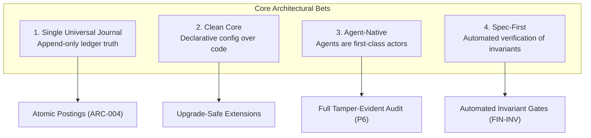
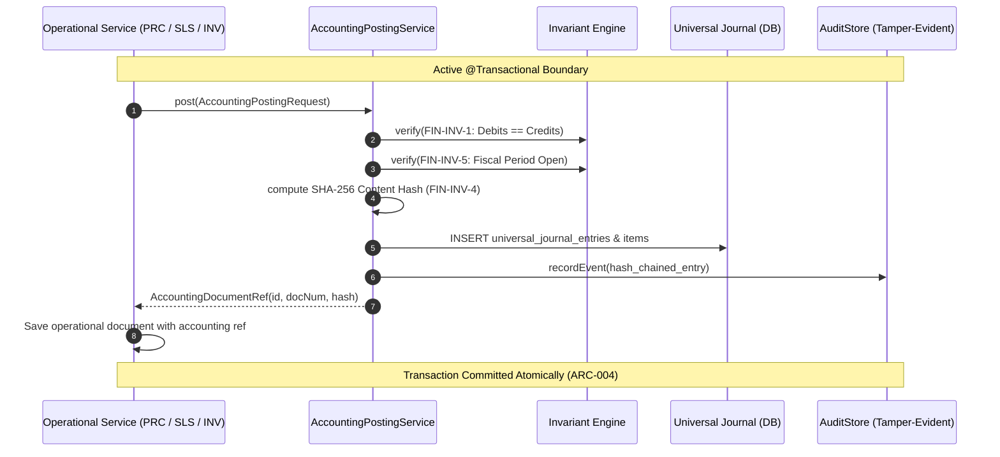

# Atlas ERP

> **Cloud-Native, Modular, Agent-First ERP Platform**  
> *Designed for Spec-Driven Implementation in Google Antigravity*

[](https://openjdk.org/projects/jdk/21/)
[](https://kotlinlang.org/)
[](https://spring.io/projects/spring-boot)
[](https://spring.io/projects/spring-modulith)
[](https://www.postgresql.org/)
[](#architecture)

---

## 1. Overview

**Atlas ERP** is an end-to-end, SAP-class enterprise resource planning platform engineered from the ground up around a **single immutable ledger**, **declarative configuration**, **clean modular boundaries**, and **governed autonomous AI agents**.

Atlas covers core lines of business matching SAP S/4HANA:
- **Finance (FI/CO)**: General Ledger, Parallel Ledgers, Accounts Payable, Accounts Receivable, Universal Journal.
- **Sourcing & Procurement (MM-PUR)**: Purchase Requisitions, RFQs, Purchase Orders, Goods Receipt, 3-Way Invoice Verification.
- **Sales & Distribution (SD)**: Quotations, Sales Orders, Deliveries, Goods Issue, Customer Billing.
- **Supply Chain & Inventory (MM-IM)**: Stock Movement Ledger, On-Hand Balances, Real-Time Valuation.
- **Platform Foundation (Basis/BTP)**: Multi-Entity Org Hierarchy, IAM & RBAC, Number Ranges, Tamper-Evident Audit Trails, Decoupled AI Model Gateway.

---

## 2. The Four Core Bets



1. **Single Append-Only Universal Journal (`DAT-001`, `P1`)**: Every financial and controlling effect posts to one line-item store (`fin.universal_journal_entries` & `fin.universal_journal_items`). All subledgers reconcile to it by construction. Documents are permanently immutable; corrections are executed exclusively via reversal entries (`FIN-GL-007`).
2. **Clean Core, Open Edges (`P3`)**: Standard behavior is never hacked. Custom behaviors use declarative decision tables, versioned configuration (`plt_cfg`), and side-by-side APIs.
3. **Agent-Native Architecture (`P6`, Section 10)**: AI agents act under `PrincipalType.AGENT` with revocable credentials, per-tool permissions, and spending limits. They call the exact same APIs and write to the exact same tamper-evident audit log as humans.
4. **Spec-First Verification (`P8`)**: Non-negotiable accounting rules are expressed as executable invariants (`FIN-INV-1` to `FIN-INV-5`) tested automatically.

---

## 3. Financial Invariants & The Atomic Posting Rule

Atlas enforces strict accounting invariants that prevent dirty writes and financial discrepancies:

| Invariant | Description | Verification Gate |
| :--- | :--- | :--- |
| **`FIN-INV-1`** | **Debits equal Credits**: Every journal entry must balance per document and currency. | `AccountingGatewayImpl` throws `InvariantViolationException` on mismatch |
| **`FIN-INV-2`** | **Subledger Reconciliation**: Sum of open items in AP/AR equals the reconciliation account balance. | Automated property tests & reconciliation queries |
| **`FIN-INV-3`** | **Trial Balance Integrity**: Trial balance for any period equals the exact sum of line items. | jOOQ-powered aggregate reporting |
| **`FIN-INV-4`** | **Cryptographic Immutability**: Every posted document computes a SHA-256 content hash verified against tampering. | Hash computed and sealed upon posting |
| **`FIN-INV-5`** | **Fiscal Period Gate**: Postings are blocked if the target accounting period is closed. | Period status check before commit |
| **`ARC-004`** | **Atomic Posting Rule**: Operational documents and accounting entries commit in the exact same DB transaction. | Synchronous in-transaction invocation |

### The Atomic Posting Lifecycle



---

## 4. Module Map & Architecture

Atlas is organized as a **Modular Monolith** using Gradle multi-projects and Spring Modulith for compile-time and runtime boundary verification:

```
Atlas/
├── atlas-platform/
│   ├── plt-common/              # Value objects (Money, Quantity, TenantId, UUIDv7, Invariants)
│   ├── plt-org/                 # Company, Plant, StorageLocation, CostCenter, ProfitCenter
│   ├── plt-iam/                 # Identity, AtlasPrincipal (HUMAN, AGENT), SoD validation
│   ├── plt-doc/                 # Document flow links, Number ranges, Idempotency records
│   ├── plt-aud/                 # Append-only SHA-256 hash-chained audit store
│   ├── plt-cfg/                 # Versioned business policy configuration
│   └── plt-ai/                  # Decoupled Model Gateway & Governed Agent Actor Runner
│
├── atlas-finance/
│   ├── fin-accounting-api/      # AccountingGateway interface, posting contracts & DTOs
│   ├── fin-accounting-core/     # Universal Journal persistence, Invariant engine, jOOQ reporting
│   ├── fin-gl/                  # General Ledger, Chart of Accounts, Fiscal Periods
│   ├── fin-ap/                  # Accounts Payable, Supplier Invoices, Open Item tracking
│   └── fin-ar/                  # Accounts Receivable, Customer Invoices, Incoming Cash clearing
│
├── atlas-procurement/           # Purchase Orders, Goods Receipt, 3-Way Invoice Matching
├── atlas-sales/                 # Sales Orders, Delivery / Goods Issue, Customer Billing
├── atlas-inventory/             # Stock Movement Ledger, Valuation, On-Hand Balances
│
└── atlas-app/                   # Spring Boot 3 Executable App, Flyway Migrations, REST APIs
```

---

## 5. Technology Stack & Design Decisions

- **Runtime**: Kotlin 2.0.21 on OpenJDK 21 LTS with Virtual Threads support.
- **Persistence**: Hybrid Spring Data JPA (Hibernate 6) for domain entities + jOOQ 3.19 for high-speed ledger reporting queries.
- **Multi-Tenancy**: Shared database with `tenant_id` on all tables, enforced by **PostgreSQL Row-Level Security (RLS)** via session variable `SET LOCAL app.current_tenant_id` and Hibernate `@TenantId`.
- **Database Migrations**: Flyway 10.x with isolated PostgreSQL schemas (`plt_org`, `plt_iam`, `plt_doc`, `plt_aud`, `plt_cfg`, `fin`, `prc`, `sls`, `inv`).
- **Monetary Types**: Strict fixed-point `BigDecimal` via `Money(amount, currency)` with ISO currency registries and rounding modes. Floating-point types are strictly forbidden.
- **API Contracts**: OpenAPI 3.1 via Springdoc Swagger UI at `/swagger-ui.html`.

---

## 6. Getting Started

### Prerequisites

- **Java Development Kit (JDK)**: OpenJDK 21 or higher
- **PostgreSQL**: 15+ (with multi-schema support)
- **Gradle**: 8.10+ (or use `./gradlew`)

### Quick Setup

1. **Clone the repository**:
   ```bash
   git clone https://github.com/your-org/atlas-erp.git
   cd atlas-erp
   ```

2. **Configure Database**:
   Create a PostgreSQL database named `atlas_erp`:
   ```sql
   CREATE DATABASE atlas_erp;
   ```

3. **Build the Project**:
   ```bash
   ./gradlew clean build
   ```

4. **Run Unit and Invariant Tests**:
   ```bash
   ./gradlew test
   ```

5. **Start the Application**:
   ```bash
   ./gradlew :atlas-app:bootRun
   ```

6. **Explore OpenAPI / Swagger Documentation**:
   Navigate to [http://localhost:8080/swagger-ui.html](http://localhost:8080/swagger-ui.html) to interact with the live REST APIs.

---

## 7. Core REST API Endpoints

### Universal Journal & Financial Close
- `POST /api/v1/finance/journal/post` — Post a balanced journal entry atomically into the Universal Journal.
- `POST /api/v1/finance/journal/reverse` — Reverse a posted journal entry with a referenced inverse document.
- `GET /api/v1/finance/journal/trial-balance` — Generate a real-time Trial Balance report using jOOQ.

### Sourcing & Procurement (Source-to-Pay)
- `POST /api/v1/procurement/orders` — Create and approve a Purchase Order.
- `POST /api/v1/procurement/orders/{id}/receipt` — Post Goods Receipt with atomic stock debit and GR/IR credit.
- `POST /api/v1/procurement/orders/{id}/invoice` — Execute 3-way invoice match, clearing GR/IR and posting to AP.

### Sales & Order-to-Cash
- `POST /api/v1/sales/orders` — Create and confirm a Sales Order.
- `POST /api/v1/sales/orders/{id}/delivery` — Post Delivery & Goods Issue with atomic COGS and stock reduction.
- `POST /api/v1/sales/orders/{id}/billing` — Generate Customer Billing with atomic revenue and AR entry.

### Inventory & Stock Movements
- `POST /api/v1/inventory/movements` — Post material movements (e.g. 561 initial upload, 201 consumption).

### Audit Trail
- `GET /api/v1/audit/events/{entityId}` — Retrieve the tamper-evident SHA-256 chained audit history for any entity.

---

## 8. Agent Instructions & Contributing

Please review [AGENTS.md](file:///home/zabedin/projects/Atlas/AGENTS.md) for full architectural guidelines, spec-driven development practices, and non-negotiable invariant testing requirements.
